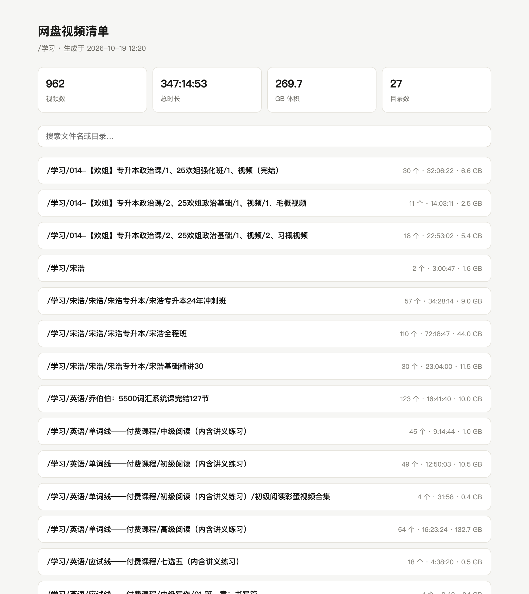
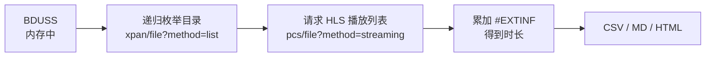

# bdpan-duration

**批量读取百度网盘视频时长，生成一份可搜索的资产清单。**

零依赖 · 单文件 · 纯标准库 · 不上传任何数据

> [!IMPORTANT]
> **你的 BDUSS 只存在于本机内存。** 不写磁盘、不写日志、不上传、没有任何服务端——所有请求从你的电脑直连百度，中间不经过作者或第三方。代码是单文件纯标准库，五分钟能读完。详细说明见下方「凭证边界」一节。

```bash
python3 bdpan-duration.py /学习
```

跑完得到 `inventory.html`——能按文件名搜索、按目录折叠、带总时长统计的本地网页。



---

## 🔐 凭证边界（请先读这一段）

这个工具需要你的百度网盘登录态（`BDUSS`）。说清楚它被怎么处理，比说十遍"请放心"有用：

- **BDUSS 只存在于当前进程的内存里。** 不写磁盘、不写日志、不写配置文件、不上传。
- **没有任何服务端。** 所有请求从你的电脑直连 `pan.baidu.com` / `d.pcs.baidu.com`，中间不经过作者或任何第三方。
- **代码是单文件、纯标准库。** 你可以用 5 分钟读完 `bdpan-duration.py` 全文，确认它只做了一件事：发 HTTP 请求、把响应里的数字加起来。
- **不下载、不回写、不删除。** 全程只读，对网盘内容零改动。
- 如果你介意，请不要使用。如果你 fork 后要加统计上报，请改个名字，别让用户误以为还是原版。

`BDUSS` 等同于你的网盘登录凭证。虽然本工具不会把它发到任何地方，但**任何要求你提供 BDUSS 的在线服务都应该被怀疑**——包括伪装成本项目的网站。

---

## 为什么需要它

百度网盘网页端只告诉你文件多大，**不告诉你视频有多长**。官方开放平台的 `file/metas` 接口返回 `size`、`md5`、`category`，唯独没有 `duration`。

也不能靠体积估算：同样是高数课，4K 原片平均码率可能是 480p 的几十倍，体积差几十倍而时长一样。实测某盘里 132 GB 的 54 集课程和 15 GB 的 59 集课程，时长几乎相同。

所以只能一个一个去问播放器。**这个工具就是把"一个一个点开看时长"自动化掉。**

## 工作原理



1. 用登录态调用 `pan.baidu.com/rest/2.0/xpan/file?method=list`，递归遍历目录，每页 100 条翻页。
2. 对每个视频请求 `d.pcs.baidu.com/rest/2.0/pcs/file?method=streaming&type=M3U8_AUTO_480`——**这正是网页播放器点开视频时发出的同一个请求**。
3. 返回的是一份 HLS 分片清单（m3u8），把每行 `#EXTINF:6.000` 的秒数累加，就是时长。
4. 用 `#EXT-X-ENDLIST` 判断清单是否完整；不完整说明转码还没跑完，等待后重试。

> ⚠️ **第 3 步有个坑**：如果走的是分享链接的播放通道，接口只会返回前 100 秒的试看片段，看起来"成功"了但数字完全错。所以必须用**自己的登录态**访问 `d.pcs.baidu.com`，不能用匿名或分享页的接口。本工具已经处理了这一点。

## 快速开始

需要 Python 3.7+，**不需要 pip install 任何东西**。

```bash
git clone https://github.com/<your-name>/bdpan-duration.git
cd bdpan-duration

# 先试 5 个，确认能跑通
python3 bdpan-duration.py /学习 --limit 5

# 没问题再全量跑
python3 bdpan-duration.py /学习 --out ./report
```

Windows 上把 `python3` 换成 `python` 或 `py`。

### 获取 BDUSS（第一次用会提示你粘贴）

任选一种：

**方式一：从浏览器复制（推荐，零依赖）**

1. 登录 [pan.baidu.com](https://pan.baidu.com)
2. 按 `F12` 打开开发者工具 → `Application`（Chrome/Edge）或 `存储`（Firefox）
3. 左侧 `Cookies` → `https://pan.baidu.com`
4. 找到名为 `BDUSS` 的那一行，复制 `Value` 列的完整内容

**方式二：让它自己去读（需要额外装一个包）**

```bash
pip install browser_cookie3
python3 bdpan-duration.py /学习 --from-browser --limit 5
```

macOS 会弹钥匙串授权框，点"允许"即可。Windows 上可能需要关掉 Chrome 的进程锁定。

**方式三：环境变量**

```bash
export BAIDU_BDUSS="你的BDUSS"
python3 bdpan-duration.py /学习
```

不要用 `--bduss` 直接写在命令行里——它会进入 shell 历史记录。

## 命令行参数

| 参数 | 说明 | 默认 |
|---|---|---|
| `dir` | 要扫描的网盘目录，如 `/学习` | 必填 |
| `--out` | 输出目录 | `./bdpan-report` |
| `--limit` | 最多处理多少个文件，用于试跑 | 全部 |
| `--workers` | 并发数 | `4` |
| `--ext` | 只扫这些扩展名，逗号分隔 | `.mp4,.m4v,.mov,.mkv,.avi,.flv,.wmv,.webm,.ts` |
| `--from-browser` | 从本机浏览器读 Cookie | 关 |
| `--bduss` | 直接传入 BDUSS（会留 shell 历史，不建议） | — |

### 并发怎么调

- **默认 4 已经够快**，1000 个文件大约 10–20 分钟。
- 如果出现 `120 触发访问频率限制` 或大量失败，**降到 2**。
- **不要超过 8**。请求打太猛可能触发临时限制，属于得不偿失。

## 输出

跑完在 `--out` 目录下生成三个文件：

| 文件 | 用途 |
|---|---|
| `inventory.html` | **主推**。自包含网页，双击打开，支持搜索、目录折叠、时长统计 |
| `inventory.csv` | 导入 Excel / Numbers / 表格工具；已带 UTF-8 BOM，中文不乱码 |
| `inventory.md` | 直接贴进笔记或 Notion |

CSV 字段：

| 字段 | 说明 |
|---|---|
| `目录` | 视频所在目录的完整路径 |
| `文件名` | 视频文件名 |
| `时长` | `H:MM:SS` 或 `M:SS` |
| `秒` | 精确秒数（浮点），方便自己算总和 |
| `大小GB` | 文件体积 |
| `码率MB/s` | 体积 ÷ 时长，可用于识别高码率原始素材 |
| `列表完整` | `是` 表示 HLS 清单完整，数字可信 |
| `错误码` | 失败时的错误码，见下方排查 |

## 常见问题

**拿到很多 `列表完整=否` 怎么办？**

文件刚上传或很久没被播放过时，百度需要先转码才能生成播放列表，此时只能拿到部分分片。工具会自动重试 4 次（间隔 0 / 12 / 25 / 40 秒），仍然不完整的会标上 ⚠️。过几分钟用 `--limit` 单独重跑那批即可。

**`31341` / `31363` 是什么？**

转码未完成 / 正在转码。不是错误，等一会儿就好。

**`-6` / `111` 是什么？**

BDUSS 失效了。重新获取一次。

**时长比播放器里看到的短一点？**

差的在 1–2 秒以内属于正常——HLS 分片是整数切分，累加结果和播放器取整方式略有差异。**如果差了几分钟甚至几倍，那就是拿到了试看片段**，请确认 `列表完整=是`，否则该数据不可信。

**会不会被限流或封号？**

本工具只读、低频（默认 4 并发）、单次扫描。正常使用风险很低，但不是零——百度对非官方接口没有承诺。**自己承担这个风险**，尤其不要拿大号跑几万文件。

**支持其他网盘吗？**

不支持。阿里云盘、夸克、115 的接口完全不同，没有通用的做法。

## 已知限制

- 只读取**你账号内**的文件。别人的分享链接不行（会走试看通道，数据错误）。
- 转码状态受百度服务端影响，冷门文件可能需要等几小时。
- 接口没有官方文档，百度随时可能改。改了这个工具就会失效——欢迎提 issue。
- 同名重复文件不会自动合并，因为它们是不同的 `fs_id`。

## 作为 Skill 使用

仓库里附带 `SKILL.md`，如果你用 Claude Code / WorkBuddy 这类支持 Skill 的 Agent，把整个目录放进 skills 目录即可通过自然语言触发：

> "帮我统计一下网盘 /学习 目录里所有视频的时长"

## 免责声明

本项目仅供个人管理自己的网盘数据使用。使用即表示你了解：这调用了百度网盘网页端的内部接口（非开放平台 API），可能违反其用户协议；账号风险由使用者自行承担。作者不对任何账号处罚、数据损失或服务变更负责。

请勿用于批量抓取他人分享内容。

## License

MIT
